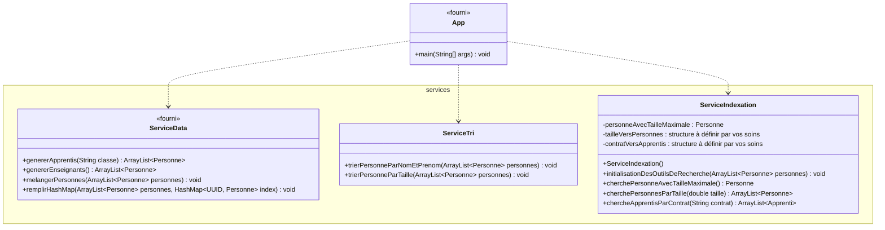
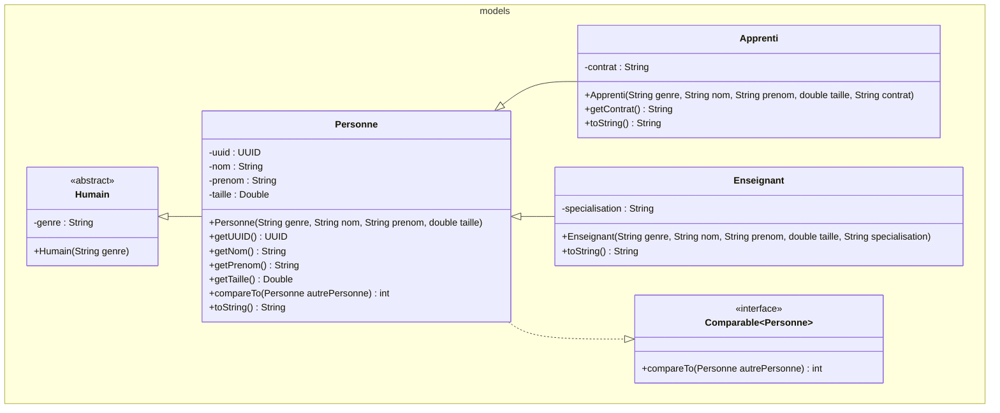

# 320 Evaluatoin formative  – Héritage, tri et indexation

## Contexte

L’école souhaite disposer d’une petite application permettant de gérer différentes personnes : des apprentis et des enseignants.

L’application doit pouvoir :

- représenter les personnes à l’aide d’une hiérarchie de classes ;
- mélanger puis trier les personnes ;
- retrouver rapidement la personne la plus grande ;
- retrouver rapidement toutes les personnes ayant une taille donnée ;
- en option, retrouver les apprentis possédant un contrat d’apprentissage donné.


## Éléments fournis

Les éléments suivants sont déjà présents dans le projet :

- la classe `App` contenant la méthode `main` ;
- la classe `ServiceData`, qui génère les apprentis et les enseignants ;
- la classe `Personne`, avec ses attributs et les signatures principales. 

La classe `Personne` est volontairement **incomplète**, vous devez la compléter en fonction du diagramme de classe

- la structure des autres classes services.


Vous ne devez pas modifier les données créées dans `ServiceData`. Le `main` sert de scénario de vérification de votre travail.

## Travail demandé

Vous devez compléter ou créer les classes représentées dans le diagramme UML, en respectant :

- les packages ;
- les noms des classes, attributs et méthodes ;
- les types indiqués ;
- les relations d’héritage et d’implémentation ;
- la visibilité des membres.

Complétez la classe `Personne` selon les besoins de la donnée

Complétez la classe `ServiceTri` selon la javadoc

Complétez la classe `ServiceIndexation` selon la javadoc

> La partie concernant `contratVersApprentis` et `chercheApprentisParContrat` est à réaliser par les plus rapides.
(il faut décommenté la fin du main)


> Question super-bonus: Que se passe-t-il si la méthode compareTo est redefinie dans Apprenti de cette manière.

    @Override
    public int compareTo(Personne autrePersonne) {
        return (this.getTaille().compareTo(autrePersonne.getTaille()));
    }

## Diagrammes de classes

### Application et services



### Modèles




# Résultats à obtenir


```text
----------Liste triée par taille.---------                                                                                                                                                                                                                                                    
Egger Nadia : 1.65 Specialisation DEV                                                                                                                                                                                                                                                         
Boon Lucas : 1.68 Contrat DEV                                                                                                                                                                                                                                                                 
Perelli Louisa : 1.68 Contrat DEV                                                                                                                                                                                                                                                             
Lâm Louis : 1.7 Contrat DEV
Yazdanpanah Yohan : 1.71 Contrat IT
Berrier Noa : 1.71 Contrat DEV
Shala Leon : 1.72 Contrat IT
Bernet Maxime : 1.72 Contrat DEV
Parent Julien : 1.74 Contrat DEV
Peyter Maxime : 1.74 Contrat DEV
Jacquet-Lagreze Aron : 1.74 Contrat DEV
Gigandet Yoan : 1.75 Contrat DEV
Meghezi Amayas : 1.76 Contrat IT
Gremaud Thomas : 1.77 Contrat DEV
Butschi Daniel : 1.77 Specialisation DEV
Szuta Bartosz : 1.78 Contrat IT
Crausaz Esteban : 1.78 Contrat DEV
Collela Dimitri : 1.78 Specialisation DEV
Gantchev Alexander : 1.8 Contrat IT
Crovetto Tomas : 1.82 Contrat IT
Fejzulahi Seid : 1.83 Contrat IT

--------------------------------------------------
La personne la plus grande est Fejzulahi Seid : 1.83 Contrat IT
--------------------------------------------------

----------Liste des personnes de 1.78------------
Crausaz Esteban : 1.78 Contrat DEV
Szuta Bartosz : 1.78 Contrat IT
Collela Dimitri : 1.78 Specialisation DEV

----------Liste des Apprentis avec un contrat DEV------------
Bernet Maxime : 1.72 Contrat DEV
Berrier Noa : 1.71 Contrat DEV
Boon Lucas : 1.68 Contrat DEV
Crausaz Esteban : 1.78 Contrat DEV
Gigandet Yoan : 1.75 Contrat DEV
Gremaud Thomas : 1.77 Contrat DEV
Jacquet-Lagreze Aron : 1.74 Contrat DEV
Lâm Louis : 1.7 Contrat DEV
Parent Julien : 1.74 Contrat DEV
Perelli Louisa : 1.68 Contrat DEV
Peyter Maxime : 1.74 Contrat DEV
```